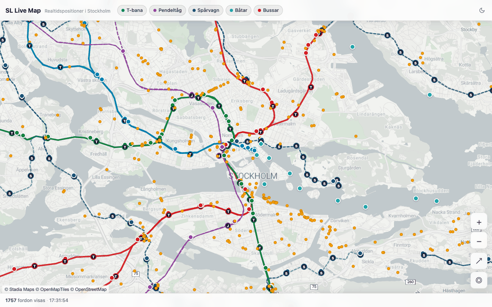

# SL Live Map – open source

*[Svenska](README.md)*

A real-time map of every bus, metro train, commuter train, tram and boat in Stockholm's public transport. I built it
and run it as a one-person project at **[sl-map.gunnar.se](https://sl-map.gunnar.se)**. This repo is the backend and
web map that power that site.

<picture>
  <source media="(prefers-color-scheme: dark)" srcset="images/readme-dark.png">
  
</picture>

Flask fetches Trafiklab's GTFS-RT feed (protobuf) and turns it into compact JSON. A page in plain JavaScript and
Leaflet fetches the vehicles every two seconds and glides them along the tracks. No build step, no framework.

## Quick start

You need Python 3 (tested with 3.13 and 3.14) and two free keys from Trafiklab (see below).

```bash
git clone https://github.com/gunnarr/sl-map-open-source.git
cd sl-map-open-source
python3 -m venv venv && venv/bin/pip install -r requirements.txt
cp .env.example .env            # add your Trafiklab keys

# Download the timetable data once and build the files the map needs (written to regions/sl/)
venv/bin/python3 build_trip_lookup.py --save-zip sl.zip    # required: line numbers and destinations
venv/bin/python3 build_stations.py --gtfs-zip sl.zip       # stations
venv/bin/python3 build_geojson.py --gtfs-zip sl.zip        # track lines

venv/bin/python3 server.py      # open http://localhost:8080
```

Without `trip_lookup.json` the server can't tell which line a vehicle runs, and the map stays empty.

The tests need no keys and no network:

```bash
venv/bin/pip install -r requirements-dev.txt
venv/bin/python -m pytest tests/ -q
npm install && node map-behaviour-test.mjs    # browser test of the map (needs Chrome, see AGENTS.md)
```

## With an AI agent

Exploring and changing the project with an AI agent such as Claude Code, Codex, Cursor, Copilot or Gemini works well.
The agent instructions are in [AGENTS.md](AGENTS.md) (`CLAUDE.md` and `GEMINI.md` point there), so most tools pick
them up by themselves. You could start with:

> Read AGENTS.md and README.en.md. Set the project up locally, run the tests and explain how the map fetches and shows
> the vehicles. Don't change anything yet.

Three things worth knowing:

- **Get the keys yourself** and put them in `.env` – don't paste them into the chat with the agent. The agent can run
  the tests and start the server without keys; only the real vehicles need them.
- **The agent can use up your quota.** Keep `VEHICLE_CACHE_SECONDS=60` while developing and ask the agent not to
  download the timetable data more than once.
- **You own the code** when you open a pull request: read it, run it and mention that an agent helped.

## Get your Trafiklab keys (free)

1. Sign up at [developer.trafiklab.se](https://developer.trafiklab.se/register) (you can log in with GitHub) and
   confirm your email.
2. Create a project with **New project**.
3. Add two APIs to the project:
   - **GTFS Regional Realtime** – put the key in `TRAFIKLAB_KEY` (vehicle positions and delays).
   - **GTFS Regional Static** – put the key in `GTFS_STATIC_KEY` (only used by the build scripts).
4. The keys work right away on the **Bronze** level, which is enough to try things out and develop.

**Mind the quotas.** Bronze gives 30,000 realtime calls a month. At the default (every two seconds) that lasts only
a little over 16 hours with the map open, so set `VEHICLE_CACHE_SECONDS=60` while developing. Static data allows 50
downloads a month – download once and reuse the file with `--gtfs-zip`. To run a public site, ask for **Silver** via
*Upgrade quota* at Trafiklab. It's free and usually approved within a couple of working days.

Never commit `.env` or keys.

## Go easy on Trafiklab: the cache is the whole point

Visitors' browsers **never** talk to Trafiklab. They only talk to your server, and the server fetches the vehicle
positions from Trafiklab **once every two seconds** and keeps the answer. Every visitor gets the latest saved answer,
whether one person is watching or ten thousand. So the number of calls to Trafiklab depends on the clock, not on how
many people visit.

This matters for three reasons:

- **The quota lasts.** A server fetching every two seconds makes about 43,000 calls a day, however popular the site
  gets. Without the cache every visitor would make their own calls and the quota would be gone in minutes.
- **The key stays secret.** It only lives on the server. Never change the map so the browser fetches straight from
  Trafiklab – the key would end up in the page source for anyone to use.
- **Faster and sturdier.** If Trafiklab is slow or briefly down, visitors get the last saved answer instead of an
  error (*stale-while-revalidate*).

Two things to keep in mind when you deploy:

- **Each server process has its own cache.** With four gunicorn workers, each fetches on its own – four times the
  calls. So put a short cache in nginx in front of `/api/vehicles`, so only one request at a time reaches the app.
  This is how I run sl-map.gunnar.se:

  ```nginx
  proxy_cache_path /var/cache/nginx/sl levels=1 keys_zone=sl_vehicles:1m max_size=10m inactive=10s;

  location /api/vehicles {
      proxy_cache sl_vehicles;
      proxy_cache_valid 200 2s;
      proxy_cache_key "$request_uri";
      proxy_cache_lock on;                 # only one request at a time fills the cache
      proxy_cache_use_stale error timeout updating http_500 http_502 http_503;
      proxy_pass http://127.0.0.1:8080;
  }
  ```

- **The browser only fetches changes.** After the first answer the map asks for `/api/vehicles?since=…` and gets only
  the vehicles that moved, appeared or disappeared. That saves about 40 % of the traffic between server and visitors.

While developing you can set `VEHICLE_CACHE_SECONDS=60` so the server only fetches once a minute.

## Run your own copy

Everything that differs from one site to the next lives in a few places:

- **`site-config.js`** – map tiles, analytics (Plausible), the iPhone app banner and which menu links are shown. The
  comments in the file explain each part.
- **`.env`** – keys, `SITE_DOMAIN` (your domain, used for CORS) and `VEHICLE_CACHE_SECONDS`.
- **`map.html`** – at the top of `<head>` are the sharing tags (Open Graph), `canonical` and structured data (JSON-LD)
  with sl-map.gunnar.se as the address. They have to be in the HTML itself because link-preview bots don't run
  JavaScript. Change them to your own address, or remove them.
- **`manifest.json`** and the icons – name and icon when the map is added to a home screen.

## Map tiles

By default the map uses [Stadia Maps](https://stadiamaps.com), which works on localhost without a key. In production,
register your domain with Stadia, or pick another preset in `site-config.js`: CARTO (with your own key) or
OpenStreetMap.

## Other cities

The backend can run other transit regions available in GTFS Regional. Copy `regions/sl/` to `regions/<operator>/`,
adjust `config.json` (names, line colours, metro groups) and set `REGION` in `.env`. The build scripts take
`--operator <operator>`. The map page itself is built for Stockholm (start view, texts), so another city also needs its
own `map.html` in `regions/<operator>/` – the server prefers it over the one in the root.

## What's not here

The iPhone, iPad and Apple TV apps are separate projects and not part of this repo. Neither are the site's other
pages, my deploy scripts, analytics or newsletter. Questions about the apps go through the contact form at
[sl-map.gunnar.se](https://sl-map.gunnar.se).

## Contributing

I'm one person, so replies can take a while. Read [CONTRIBUTING.md](CONTRIBUTING.md), and please open an issue before
bigger changes. Report security problems as described in [SECURITY.md](SECURITY.md).

## License and credits

- Code: [AGPL-3.0](LICENSE). If you run a modified version as a public web service, its visitors must be able to get
  the source code.
- Transit data: Trafiklab / Samtrafiken, [CC0](https://www.trafiklab.se/api/gtfs-datasets/gtfs-regional/).
- Map data © [OpenStreetMap contributors](https://www.openstreetmap.org/copyright) (ODbL). Tiles from the provider you
  choose.
- [Leaflet](https://leafletjs.com), BSD-2-Clause. See [THIRD_PARTY_NOTICES.md](THIRD_PARTY_NOTICES.md).

This is an independent project, not affiliated with SL, Region Stockholm, Samtrafiken or Trafiklab. The name and icons
are not covered by the code license.
